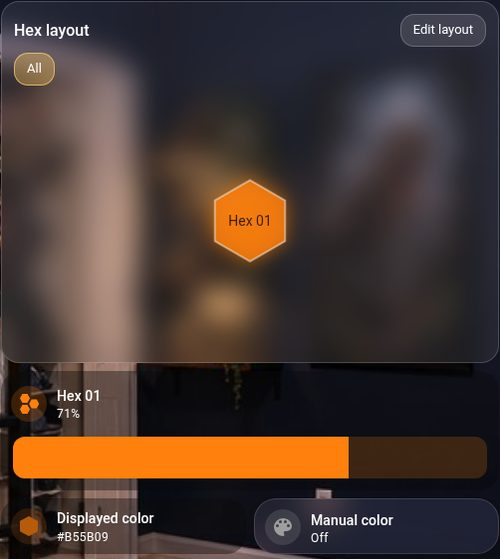
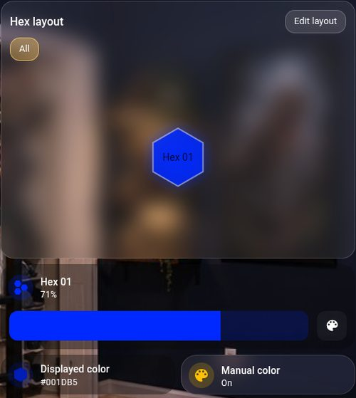
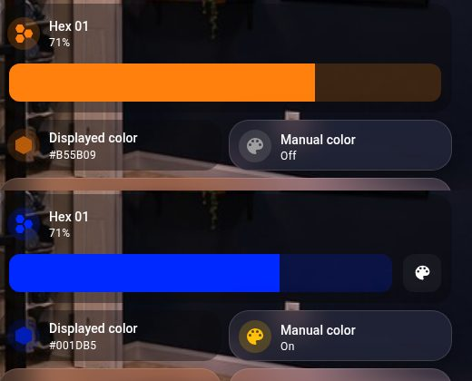
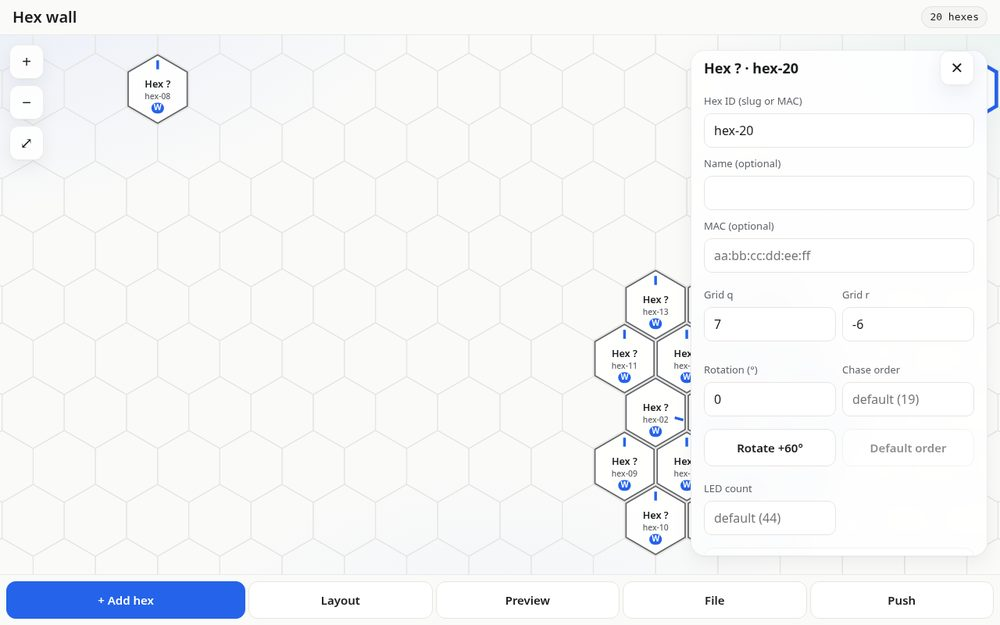

# Hex Lights

Hexagon LED tiles for your wall. Each tile is an ESP32-S3 Super Mini running about 44 WS2812B LEDs on ESPHome. The tiles sync with each other wirelessly over ESP-NOW, so you don't need data wires between them, and you control everything from Home Assistant.



## Features
- **Up to 20 tiles**, named **Hex 01** through **Hex 20**. Hex 01 is the master and holds the wall-wide controls.
- **Boots at 30 % brightness** every time. The slider goes all the way to full brightness with no cap.
- **Manual color toggle.** When it's on, the wall shows one solid color that you pick. When it's off, you get **Effect, Palette, Speed and Wipe axis**.
- **Effects:** solid, radial wave, rainbow sweep, pulse, chase, wipe, rainbow flow, random ripple, twinkle, color cycle and snake.
- **Palettes:** rainbow, ocean, sunset, forest, fire and mono.
- **Displayed color sensor** (`sensor.hex_NN_displayed_color`, `#RRGGBB`). It reports what the tile is actually showing, so dashboard colors match the wall even while an effect runs.
- **Layout card and editor.** A live hex map for your dashboard, plus a browser editor for arranging tiles.
- Effect, palette and speed settings come back after a reboot.

## Gallery
| Manual color off: brightness only, plus effects | Manual color on: pick a color |
|---|---|
|  |  |

| Card states side by side | Layout editor (`web/`) |
|---|---|
|  |  |

## Parts (per tile)
- ESP32-S3 Super Mini
- WS2812B strip, about 44 LEDs (GRB, data on **GPIO13**)
- A 3D-printed hexagon shell

For power, wiring and the optional jumper sync wire, see [DESIGN.md](DESIGN.md).

## Quick start
You need Home Assistant with the **ESPHome Device Builder** add-on, or the `esphome` CLI (tested with 2025.9.3 and 2026.9.1).

1. **Get the files.** Copy this repo's `esphome/` folder into your ESPHome config folder. With the add-on, that's `/config/esphome/`, so you end up with `/config/esphome/hex-lights/esphome/...`.
   ```bash
   git clone https://github.com/temeyers/hex-lights.git
   ```
2. **Add your secrets.** Copy `secrets.example.yaml` to `esphome/tiles/secrets.yaml` and fill it in. Git ignores this file, so never commit it.
   ```yaml
   wifi_ssid: "your wifi"
   wifi_password: "..."
   fallback_ap_password: "at least 8 chars"
   ota_password: "..."
   api_key: "..."   # generate with: openssl rand -base64 32
   ```
3. **Flash Hex 01.** Plug the first tile in over USB-C:
   ```bash
   esphome run esphome/tiles/hex-01.yaml
   ```
   In the Device Builder, open `tiles/hex-01.yaml` and choose **Install → Plug into this computer**. After the first flash, updates go over Wi-Fi.
4. **Flash the other tiles** the same way: `hex-02.yaml`, `hex-03.yaml`, and so on up to `hex-20.yaml`.
   > **Every tile must run the same firmware build** (sync packet v3). If you change anything, re-flash all of them.

## Install the card with HACS
The **Hex layout card** can be installed through HACS as a custom **Dashboard** repository.

[](https://my.home-assistant.io/redirect/hacs_repository/?owner=temeyers&repository=hex-lights&category=plugin)

Or by hand:
1. In Home Assistant, open **HACS**, then **⋮ (top right)**, then **Custom repositories**.
2. Repository: `https://github.com/temeyers/hex-lights`. Type: **Dashboard**. Click **Add**.
3. Search for **Hex Lights Layout Card**, then **Download**, then reload the browser.
4. HACS adds the resource for you (`/hacsfiles/hex-lights/hex-lights.js`). Use the card as `type: custom:hex-layout-card` (see `ha/cards/quins_room_hex_cards.yaml`).

If you install the card through HACS, skip the manual copy steps under *Dashboard cards* below, and don't add the `/local/...` resource as well.

## Add to Home Assistant
Each tile shows up on its own. Home Assistant auto-discovers ESPHome devices on your network. You can also add them by hand:

[](https://my.home-assistant.io/redirect/config_flow_start/?domain=esphome)

Enter `hex-01.local` (or the tile's IP address) and the `api_key` from your secrets. Repeat for each tile.

**Wall controls (recommended).**
1. Enable packages in `configuration.yaml`:
   ```yaml
   homeassistant:
     packages: !include_dir_named packages
   ```
2. Copy `ha/packages/hex_wall.yaml` and `ha/hex_wall.generated.yaml` into `/config/packages/`. `ha/packages/hex_wall_recorder.yaml` is optional.
3. Restart Home Assistant.

This adds the wall helpers: Manual color, effect, palette, speed, wipe axis and max brightness.

**Dashboard cards** (manual install, or use HACS above).
1. Install **Mushroom** and **card-mod** from HACS.
2. Copy `ha/cards/hex-layout-card.js` to `/config/www/hex-layout-card/`.
3. Add it as a dashboard resource: `/local/hex-layout-card/hex-layout-card.js?v=5`, type **JavaScript module**.
4. Paste the cards from `ha/cards/quins_room_hex_cards.yaml` into a view, using the raw configuration editor.

There's also a ready-made full dashboard: `ha/hex_wall_dashboard.generated.yaml`.

## Using it
One panel drives the whole wall or a single tile:
- **Target** (`input_select.hex_wall_target`): `All` or `Hex NN`. Tap a hex in the layout card to target it; tap it
  again (or the **All** chip) to go back to All. Hold a hex for its more-info dialog. **⏻ … on/off** switches the
  current target (all on → off, otherwise on). Picking **All** also turns on any tile that was switched off on its own.
- **Hex** light card (`light.hex_target`): brightness and colour for the target.
- **Manual color** (`switch.hex_target_manual_color`) on: each tile shows its own solid colour. **White shade** slider
  (2000–6500 K) and **Warm 2700K / Neutral 4000K / Cool 6500K** buttons appear (`script.hex_target_white`,
  `number.hex_NN_white_temperature`). The LEDs are RGB-only, so colour temperature is emulated in the firmware.
- **Manual color** off: Effect / Palette / Speed / Wipe axis are shown and applied to the target
  (`script.hex_wall_fx_apply` calls `esphome.hex_NN_set_wall_fx` on every targeted tile).
- HexSync is always on in the firmware (it's the only effect; "None" is switched straight back).
- To change the tile arrangement without re-flashing, use the layout card's **Edit layout** (new tiles wait in the
  *Tray*), the layout editor (`web/`; see [web/README.md](web/README.md)) or `esphome.hex_01_set_layout_bulk`.

## Adding Hex 04 and up
1. Flash the tile with the template (`tools/gen_tiles.py` writes `esphome/hex-NN.yaml`; same build as the others).
2. **One-time step:** adopt it in Home Assistant (Settings → Devices → ESPHome → *Configure* on the discovered
   `hex-NN`, or add `hex-NN.local` by hand) and make sure the device is called `Hex NN`, so its entities are
   `light.hex_NN_light`, `switch.hex_NN_manual_color` and so on. If HA put an area prefix on them
   (`light.quins_room_hex_NN_light`), rename the entity IDs back to `…hex_NN_…`.
3. That's all. Everything else finds `*.hex_NN_*` entities by pattern at runtime:
   - the Target dropdown is rebuilt (All + sorted `Hex NN`) on HA start, on every entity-registry change, after an
     automation reload and once a minute (`automation.hex_wall_target_list_all_flashed_tiles`); the static seed is just `All`;
   - All fan-out (light, manual colour, white shade, effects, max brightness, current limit, LED count) uses
     templates over `light.hex_*_light`, `switch.hex_*_…` and `number.hex_*_…`, not fixed lists;
   - the layout card lists every `light.hex_NN_light`; a new one sits in the Tray until you place it.
   - Not dynamic (HA limitation): the `light.hex_wall` light group, the `sensor.hex_wall_displayed_color` group and
     the sync-source triggers are generated for Hex 01–20. Nothing in the panel depends on them; tiles above 20 need
     a re-run of `tools/gen_tiles.py`.

## Troubleshooting
- **A tile isn't syncing.** Make sure every tile runs the same build (device info shows `Project temeyers.hex-lights` and the version). Re-flash any odd one out. Tiles on different Wi-Fi APs may be on different channels and then can't hear each other over ESP-NOW (`sensor.hex_NN_peers_seen` = 0).
- **Onboard LED blinking.** The ESP32-S3 Super Mini's onboard LED (GPIO48) is claimed by the firmware and held off (`onboard_led`, internal). If it still blinks, it's the hardwired red power LED, which firmware can't control.
- **Tiles reboot at full-brightness white.** All 44 LEDs at full white draw far more than any colour. If the supply can't keep up, the tile browns out and restarts at 30 %. Turn on **Current limit** or use a bigger supply.
- **"Invalid api_key" when compiling.** ESPHome 2026.x rejects placeholder keys. Generate a real one with `openssl rand -base64 32`.
- **A tile doesn't show up in HA.** Add it by hand with the button above, using `hex-NN.local` or its IP address. Check that it's on the same network or VLAN.
- **Effect colors don't match the card.** Cards should use `sensor.hex_NN_displayed_color`, not the light's color.
- **A tile was flashed under an old name.** See *Rename to hex-NN* in [docs/REFERENCE.md](docs/REFERENCE.md).

## For developers
Generators, the layout format, the sync protocol and the entity reference are in [docs/REFERENCE.md](docs/REFERENCE.md) and [DESIGN.md](DESIGN.md).

`dist/hex-lights.js` is the HACS copy of `ha/cards/hex-layout-card.js`. Keep the two files identical.

To run the tests:
```bash
python -m pytest tests && node tests/effects.test.mjs
```

*Status: Hex 01 has been built and verified. Hex 02 to 20 are generated configs and haven't been tested on hardware yet. The step-by-step install above follows the repo's files, but nobody has run it end to end on a fresh Home Assistant.*
